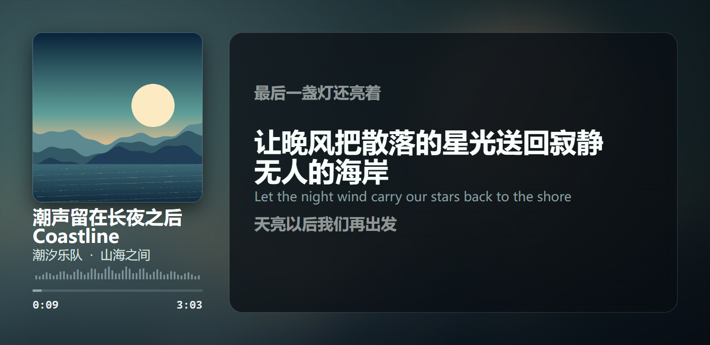

# 岚屏工作台 · LanScreenStudio

给爱国者星璨岚屏显版使用的 Windows 机箱屏工作台。用同一块 1480 × 720 屏幕显示背景、音乐歌词或专注计时。

**[下载最新版本](https://github.com/Mickey1013/LanScreenStudio/releases/latest)** · [历史版本](https://github.com/Mickey1013/LanScreenStudio/releases) · [使用说明](docs/使用说明.md) · [反馈问题](https://github.com/Mickey1013/LanScreenStudio/issues/new)

*音乐模式演示，使用示例歌曲与歌词。*

## 能做什么

- **背景画面**　选择内置预设，或导入 PNG、JPG、WebP、GIF、MP4。可叠加时钟和硬件信息，也可把预览保存为 PNG。
- **音乐歌词**　通过 Windows 媒体会话读取曲名、封面和播放状态。支持网易云音乐同步歌词、LRCLIB 查找和本地 LRC，提供双语滚动与单行大字两种布局。
- **实时频谱**　可显示系统混音或当前播放器的音频。当前播放器频谱需要 Windows 内部版本 20348 或更高。
- **专注计时**　显示任务、剩余时间、专注轮次和下一阶段。可设置专注与休息时长。
- **投屏控制**　关闭窗口后可在系统托盘继续投屏。USB 恢复连接后可自动续投。

## 支持范围

| 项目 | 支持情况 |
| --- | --- |
| 机箱 | 爱国者星璨岚屏显版，6 英寸机箱屏 |
| 画布 | 1480 × 720 |
| USB 设备 | VID `1D6B` / PID `0113` |
| 已实测固件 | `V1.0.7` |
| 系统 | Windows x64 |
| 其他机箱或小屏 | 兼容性需针对具体型号和固件验证 |

## 安装与使用

1. 打开 [最新 Release](https://github.com/Mickey1013/LanScreenStudio/releases/latest)，在 **Assets** 下下载 Windows x64 便携版。下载分卷时，请按该 Release 的说明把同版本的全部分卷放在同一目录，用 Bandizip 解压。解压后运行 `LanScreenStudio.exe`。
2. 从系统托盘退出正在控制屏幕的 AIGO 程序，把机箱屏连接到电脑。
3. 在工作台选好显示模式，点击 **开始投屏**。需要停止时可从窗口或托盘操作。

使用网易云音乐时，请在播放器的 **设置 → 常规 → 系统** 中开启 SMTC。遇到歌词不同步时，可先输入播放器当前进度进行对齐，然后按需要调整歌词偏移。

## 反馈与许可

报告问题时请附上工作台版本、Windows 版本、屏幕型号及固件、复现步骤，以及工作台显示的错误信息。

应用采用 [GPL-3.0-or-later](LICENSE)。第三方依赖、参考项目与署名见 [CREDITS.md](CREDITS.md)。
